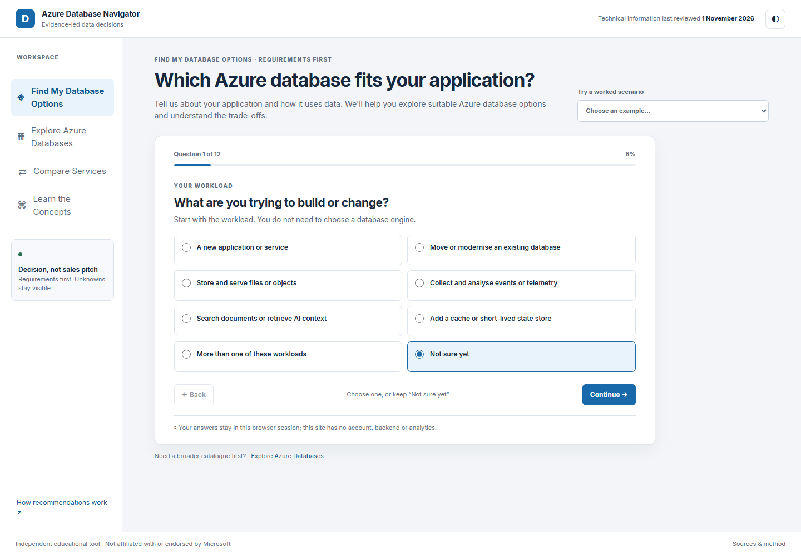
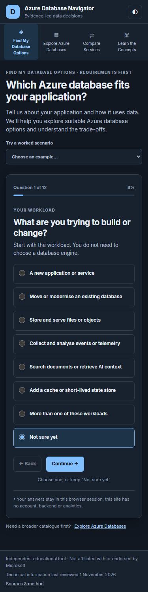
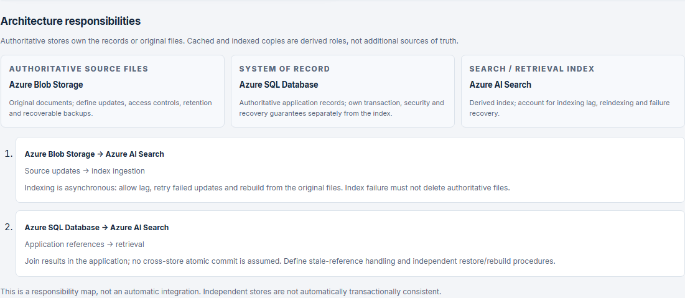

# Azure Database Navigator

An independent, evidence-led educational guide to choosing data stores and database services on Microsoft Azure. The assessment starts with workload and access patterns, keeps uncertainty explicit and explains why each candidate appears. It does not estimate price, size capacity, promise compatibility or replace engineering review.

**Status:** implemented and locally verified; GitHub Pages has not been enabled or deployed. The images below are genuine captures of the local build, not deployment evidence. Technical information was reviewed on **1 November 2026**.





## What it helps distinguish

- Relational engines and service models: Azure SQL Database, Managed Instance, SQL Server on Azure VMs, PostgreSQL Flexible Server, MySQL Flexible Server and SQL database in Fabric.
- Document, distributed and API offerings: Cosmos DB for NoSQL, Cosmos DB for MongoDB RU-based, Azure DocumentDB (the current name for the vCore-based offering), other Cosmos APIs and Apache Cassandra options.
- Cache, file/object, search and analytics roles: Azure Managed Redis, Blob Storage, Table Storage, Data Lake Storage Gen2, Azure AI Search, Azure Data Explorer, Fabric Warehouse/Lakehouse/Eventhouse and OneLake.
- Multi-store designs, migration compatibility, service lifecycles, RPO/RTO, residency, network and operational questions.
- Accessible role/link architecture diagrams, grouped family-labelled explorer profiles, common-dimension comparisons and sourced performance guidance.
- Existing-first vector retrieval, qualified graph assessment and explicit relational JSON alternatives, without automatic extra-store recommendations.

The service catalogue deliberately records “unknown” when evidence does not establish support. A wire protocol is not feature parity; JSON is not a Cosmos DB shortcut; global users do not automatically require multi-region writes; caches and indexes do not silently become systems of record.

## Run locally

Requirements: Node.js 24 or later. There are no runtime dependencies. The lockfile pins build-time Markdown rendering and browser/accessibility test tools.

```sh
npm ci
npm test
npm run check
npm run build
npm run dev
```

Open `http://127.0.0.1:4173/azure-database-navigator/`. The development server serves `dist/` at both the root and the GitHub Pages-style project subpath. No Azure credentials, account, backend, runtime CDN, paid API, analytics or telemetry are used.

Assessment answers and optional notes remain in page memory. The only persisted preference is the light/dark theme in local storage.

## Browser verification and screenshots

```sh
npx playwright install chromium
npm run build
npm run test:browser
```

Chromium workflows run under `/azure-database-navigator/` at 375, 768, 1024 and 1440 px, in both themes. They cover assessment branching, back/edit/restart, stale-answer removal, every worked scenario, explorer filters, comparison limits, documentation, keyboard/focus, reduced motion, horizontal overflow and automated WCAG A/AA checks. Automated checks do not replace a real screen-reader review or testing other browser engines.

`npm run screenshots` captures actual Chromium renders into `screenshots/` using an explicit preview-only bootstrap. Run `npm run build` afterwards to create and validate the complete publication build. Screenshots are not mocks; see [capture provenance](docs/screenshots.md).



## Decision method and evidence

- [Decision model](docs/decision-model.md)
- [Research method](docs/research-method.md)
- [Architecture and build](docs/architecture.md)
- [Source register](docs/sources.md)
- [Publication checklist](docs/publication-checklist.md)

The result is a primary candidate, qualified shortlist, evidence-justified multi-store design, no-database-needed outcome, insufficient-information result or no verified match. There are no hidden scores or confidence percentages. Prices, regions, feature matrices, service limits, compliance controls and recovery guarantees must be checked against the exact current service, tier, version, API, region and configuration.

## Companion publication material

- [Article: Azure SQL, PostgreSQL, MySQL or Cosmos DB: How Do You Choose the Right Database on Azure?](docs/article.md) — the single authoritative Markdown source.
- [Unpublished LinkedIn announcement draft](docs/linkedin-announcement.md).
- [Community impact template](docs/community-impact-template.md).

The build renders documentation to `dist/docs/*.html`, with stable heading anchors and local link/image validation. It also produces `dist/publication/article.md` and a portable, standalone `dist/publication/article.html` containing embedded screenshots and styling. Use the Markdown and actual image files for Medium, or the portable HTML for a personal site. Edit only `docs/article.md`, then rebuild; generated copies are not separate editorial sources.

The announcement remains unpublished and makes no live-site or impact claim. Public application links and deployment-dependent publication checks remain pending until separately authorised deployment.

## Project boundaries

Azure Database Navigator is independent and is not affiliated with or endorsed by Microsoft. Azure product names and Microsoft Learn sources belong to their respective owners. The [Azure Compute Navigator repository](https://github.com/preciousajuru/azure-compute-navigator) and [application](https://preciousajuru.github.io/azure-compute-navigator/) are design inspiration and the companion for choosing where an application runs; no code was copied. This project has its own catalogue, rules and tests.

Source code is MIT-licensed. Original article and documentation text is licensed under CC BY 4.0; see [content licensing](docs/CONTENT-LICENSE.md).

## Contributing

Read [CONTRIBUTING.md](CONTRIBUTING.md) and open an [evidence correction](.github/ISSUE_TEMPLATE/correction.yml) when a source or claim is unclear. The deployment workflow is manual-only and requires explicit confirmation. Do not run it or enable Pages without publication authorization.
