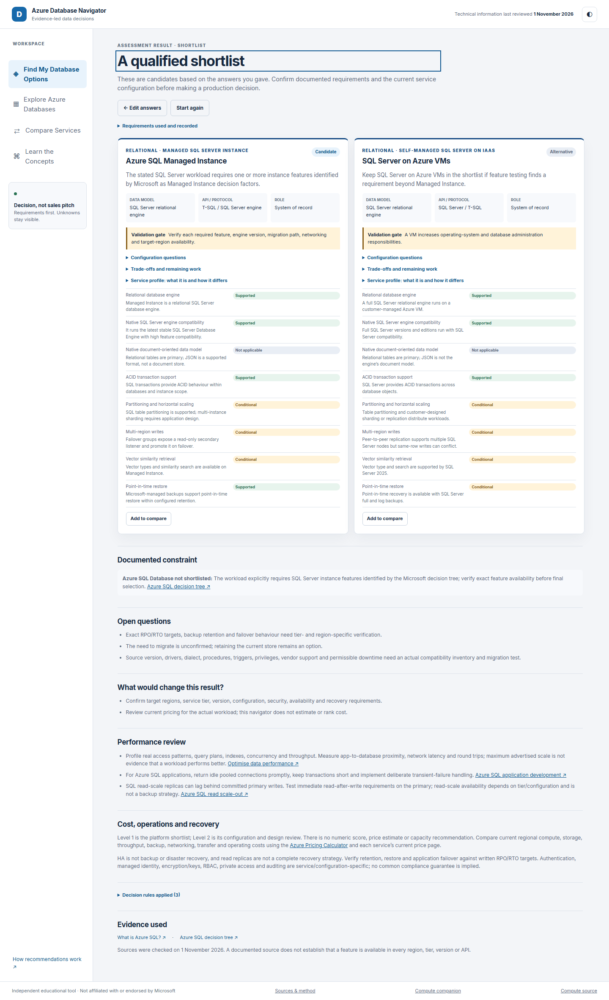
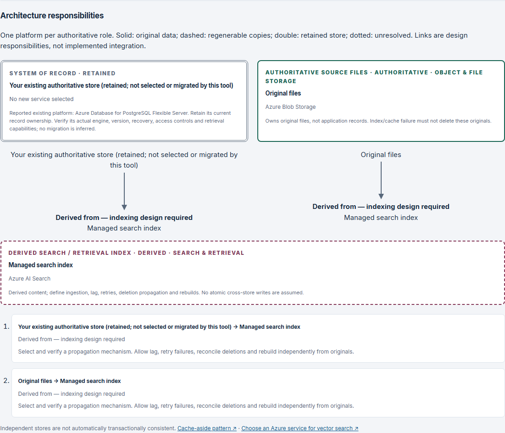

# Azure SQL, PostgreSQL, MySQL or Cosmos DB: How Do You Choose the Right Database on Azure?

By Precious Ajuru · 1 November 2026

You have an application. It works. Now it needs somewhere to keep its data.

Azure SQL Database looks reasonable. Someone suggests PostgreSQL. Then Cosmos DB enters the conversation. Before long, you are comparing products without having agreed what the application needs.

That is the wrong starting point.

Changing a database can mean changing queries, transaction boundaries, drivers and recovery procedures. It deserves more thought than picking a familiar name from the portal.

So start with the data. Not the database.

## What must happen together?

Imagine an order, its items and a payment record. Which changes must succeed or fail together? What prevents an item referring to an order that does not exist? Which questions need joins?

Those are relational questions. [Microsoft's data-model guidance](https://learn.microsoft.com/en-us/azure/architecture/data-guide/technology-choices/understand-data-store-models) describes relational stores around transactions, integrity constraints and SQL queries. Azure SQL Database and PostgreSQL Flexible Server are candidates worth comparing.

Nonrelational does not mean unstructured or careless. A document model can keep an aggregate together. Key-value storage suits known-key access. Graph traversal and time-window analytics ask different questions again.

Choose around the operations the application performs. Its programming language does not settle the engine. Neither does the fact that its API returns JSON.

*Azure Database Navigator running locally. Instance dependencies shape this migration shortlist; feature and recovery validation remain open.*

## Azure SQL is not one deployment model

With [Azure SQL Database](https://learn.microsoft.com/en-us/azure/azure-sql/database/sql-database-paas-overview?view=azuresql), the scope is the database. Microsoft manages platform patching and backups; your team still owns the schema, permissions, queries and recovery testing.

Single database or elastic pool? Provisioned or serverless compute? General Purpose, Business Critical or Hyperscale? Those are configuration questions within the service, not different database engines.

[Managed Instance](https://learn.microsoft.com/en-us/azure/azure-sql/managed-instance/sql-managed-instance-paas-overview) has an instance-shaped contract. If an existing application depends on SQL Agent, linked servers or cross-database features, investigate it. Microsoft's [SQL decision tree](https://learn.microsoft.com/en-us/azure/azure-sql/azure-sql-decision-tree?view=azuresql) helps identify those dependencies.

Do not translate “near-complete compatibility” into “nothing to test”. Check each feature against the target.

Need operating-system access, file-system control or a specific SQL Server version? [SQL Server on Azure VMs](https://learn.microsoft.com/en-us/azure/azure-sql/virtual-machines/windows/sql-server-on-azure-vm-iaas-what-is-overview?view=azuresql) exposes that control, with more operational ownership. Optional automation does not remove responsibility for patching, backups and failover.

An existing SQL Server VM is not, by itself, a reason to choose another VM.

## PostgreSQL and MySQL are engine choices

[PostgreSQL Flexible Server](https://learn.microsoft.com/en-us/azure/postgresql/overview) provides managed PostgreSQL. That matters when the application already depends on PostgreSQL behaviour or extensions.

Name the required extension. Check the [allow-list](https://learn.microsoft.com/en-us/azure/postgresql/extensions/how-to-allow-extensions), target version and configuration. “Supports extensions” is not evidence that a particular dependency will work.

[MySQL Flexible Server](https://learn.microsoft.com/en-us/azure/mysql/flexible-server/overview) is managed MySQL Community Edition. It is relational too, but that does not make SQL Server, PostgreSQL and MySQL interchangeable.

For a migration, inventory the source version, SQL dialect, procedures, triggers, drivers, privileges and vendor support. Include the time available for cutover.

Then test representative reads and writes, not just whether a connection opens. Retaining the current database is also a valid outcome when nothing justifies moving it.

## A practical example: WordPress using MariaDB

Suppose you are assessing a WordPress installation whose database is MariaDB. This is a worked example, not a claim about a real customer.

The important distinction is what retired. Microsoft [retired the Azure Database for MariaDB managed service on 19 September 2025](https://learn.microsoft.com/en-us/lifecycle/announcements/azure-products-retirement-september-2025). That notice did not retire the MariaDB engine everywhere.

MySQL Flexible Server is a candidate to assess, not a promise of a drop-in replacement.

1. Identify the actual source engine/version and hosting arrangement. Service retirement does not establish that every MariaDB installation must migrate.
2. Inventory schema, SQL modes, collations, plugins, drivers and scheduled tasks. Check the application's and plugins' supported database contracts.
3. Restore a backup into an isolated test target. Exercise publishing, account changes, plugin workflows and representative queries. Compare behaviour and inspect errors.
4. Test backup/restore, cutover time and rollback before deciding the production move. Record what has and has not passed.

“It runs WordPress” starts the compatibility exercise. It does not finish it.

## Cosmos DB: ask about access and distribution

JSON alone is not a reason to select Cosmos DB. [SQL Database supports JSON alongside relational data](https://learn.microsoft.com/en-us/sql/relational-databases/json/json-data-sql-server?view=azuresqldb-current), and [PostgreSQL has json/jsonb](https://www.postgresql.org/docs/current/datatype-json.html). Check the exact feature and engine version.

Cosmos DB for NoSQL becomes worth assessing when document access patterns and distribution requirements justify it. Its [partitioning](https://learn.microsoft.com/en-us/azure/cosmos-db/partitioning) and [consistency](https://learn.microsoft.com/en-us/azure/cosmos-db/consistency-levels) choices are design work, not boxes to ignore.

Global users do not automatically require global writes. Measure where reads and writes originate and what latency is acceptable. Relational alternatives can remain appropriate when joins, transactions or a retained engine contract matter.

MongoDB clients need their own assessment. [Azure DocumentDB is the renamed vCore-based offering](https://learn.microsoft.com/en-us/azure/documentdb/release-notes); RU-based Cosmos DB for MongoDB remains separate.

Check [DocumentDB's query-language compatibility](https://learn.microsoft.com/en-us/azure/documentdb/compatibility-query-language) and the [specific RU API matrix](https://learn.microsoft.com/en-us/azure/cosmos-db/mongodb/feature-support-42). A familiar driver does not establish feature parity.

## Sometimes another store fits better

A file archive may need Blob Storage and no database. A regenerable cache may use Managed Redis while an existing database remains authoritative. Cache-aside needs explicit expiry and invalidation; it [does not guarantee consistency](https://learn.microsoft.com/en-us/azure/architecture/patterns/cache-aside).

Telemetry queries may justify Data Explorer or Fabric Eventhouse. A timestamp on an order does not turn the application into an analytics workload.

Search and AI retrieval need the same discipline. Microsoft's [vector-search selection guide](https://learn.microsoft.com/en-us/azure/architecture/guide/technology-choices/vector-search) starts by considering the existing database. Test whether it can meet the actual retrieval requirement before adding another store.

A separate managed index can be justified for multi-source retrieval or hybrid ranking when indexing lag is acceptable. “AI” is not a requirement for a universal vector database.

*The local application shows ownership and failure boundaries. The arrows are responsibilities to design, not an implemented synchronisation mechanism.*

## A shortlist, not a league table

| Requirement to investigate | Start by assessing | Keep open |
|---|---|---|
| New relational business records | SQL Database or PostgreSQL | Engine contract and transactions |
| SQL Server instance dependencies | Managed Instance | Exact feature compatibility |
| OS or specific SQL Server version control | SQL Server on VMs | Maintenance and recovery ownership |
| Existing PostgreSQL/MySQL contract | The matching Flexible Server | Versions, extensions and migration tests |
| Distributed document access | Cosmos DB for NoSQL | Partitioning, consistency and relational JSON alternatives |
| Files, cache, retrieval or telemetry | The corresponding specialised role | Source ownership and independent failure |

## Introducing Azure Database Navigator

I built [Azure Database Navigator](https://github.com/preciousajuru/azure-database-navigator) to make those questions easier to organise.

It asks about workload, persistence, data shape, access patterns, existing engines and required data roles. Migration, retrieval and record-model questions appear when relevant. “Not sure” stays unknown.

It returns a qualified shortlist, a role-based architecture, more questions, or no new database when none is implied. Each candidate has a reason and validation gates. You can inspect the applied rule IDs and official evidence, explore structured profiles and compare services capability by capability. Each cell is Supported, Conditional, Not supported, Not applicable or Needs verification, with its official source; it never says simply "Unknown".

There are no scores, guessed prices or compatibility guarantees. It does not select capacity, configure Azure or execute a migration. Answers stay in browser memory; only the theme preference persists.

The screenshots here show the working local build, not a deployed website. The [Compute Navigator](https://preciousajuru.github.io/azure-compute-navigator/) is its separate companion for choosing where the application runs.

## The shortlist is the beginning

Before production, measure the workload. Review [queries, indexes and network round trips](https://learn.microsoft.com/en-us/azure/azure-sql/database/performance-guidance?view=azuresql), pooling and hot partitions. More advertised scale is not proof of better application performance.

Write down recovery objectives. Test restores and failover. Check region, networking, identity, encryption and cost against the exact configuration. Replicas and caches can lag; do not assume every read sees the latest write.

The useful question is not “Which Azure database is best?”

It is “Which options fit this application, and what evidence would make us choose between them?”

Start there. The product names become much easier to sort out.

---

This is an independent educational project, not affiliated with or endorsed by Microsoft. Features, availability and lifecycle can change; verify current official documentation before deployment. The screenshots show the application running locally, not a deployed website.

Original article by Precious Ajuru, licensed under [CC BY 4.0](https://creativecommons.org/licenses/by/4.0/). Microsoft product names and documentation remain subject to their owners' terms.
